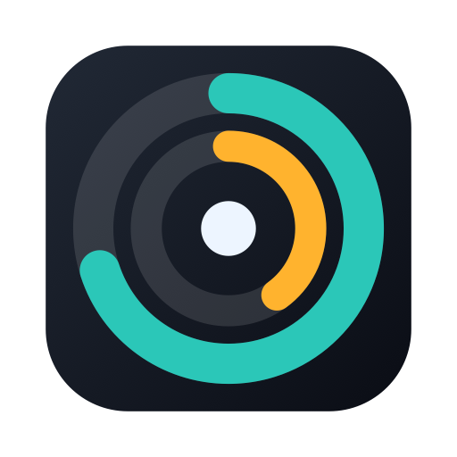
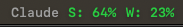
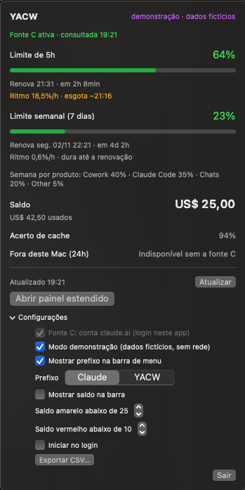
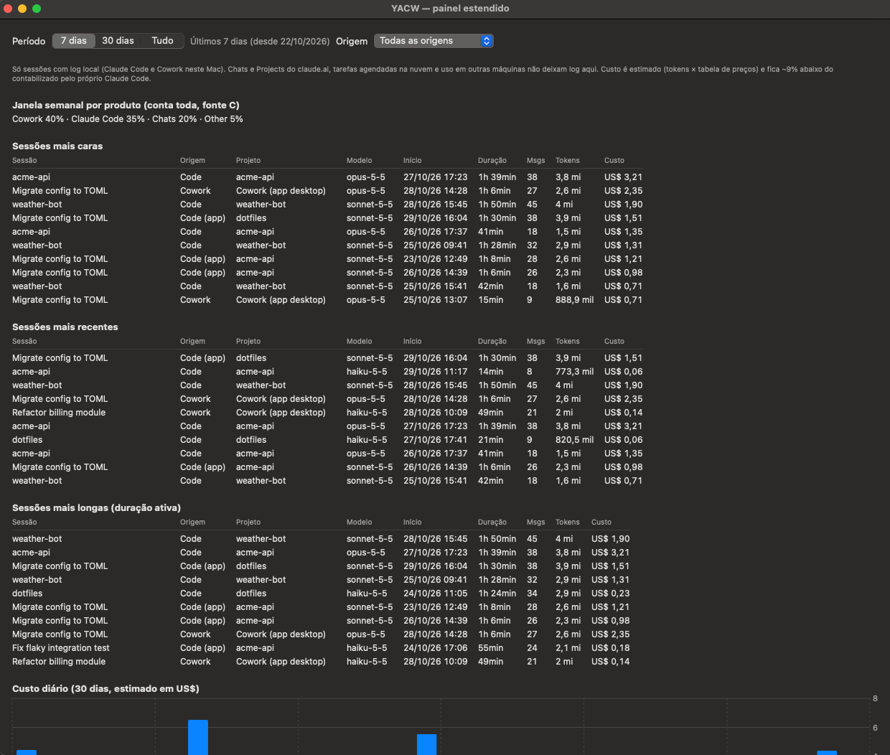

<p align="center"></p>

# YACW

**Yet Another Claude Watcher — a macOS menu bar meter for Claude usage limits**

[English](README.md)

App de barra de menu do macOS que mostra quanto dos seus limites de uso do Claude você já gastou — janelas de 5 horas e de 7 dias, quando renovam, saldo pré-pago — e um painel com as sessões do Claude Code mais caras, mais recentes e mais longas.

> **Não oficial.** O YACW é um projeto independente, **sem afiliação, endosso ou patrocínio da Anthropic**. "Claude" é marca da Anthropic; este projeto não usa logotipos da Anthropic nem do Claude. Veja [Avisos](#avisos).



<p>



*As capturas usam o modo demonstração (dados sintéticos).*

## Recursos
- Rótulo na barra de menu como `Claude S: 64% W: 23%`, colorido por faixa (verde < 70, amarelo 70–89, vermelho ≥ 90). O prefixo pode ser "Claude" (padrão), "YACW" ou oculto; o saldo pode ser acrescentado.
- Popover: janelas de 5h e 7 dias com horário e contagem regressiva de renovação, projeção de ritmo (só alerta quando o esgotamento é realmente provável), saldo de créditos pré-pagos com limiares amarelo/vermelho configuráveis, parcela da semana por produto, acerto de cache, estado das fontes.
- Painel estendido: rankings de sessões do Claude Code / Cowork (custo, recência, duração ativa) com título, origem e projeto, gráfico de custo diário, tokens por modelo e projeto, mapa de calor, filtros de período e origem, heurística de "atividade fora deste Mac".
- Notificações em 50/75/90 % e na renovação, exportação CSV, iniciar no login.
- Modo demonstração com dados sintéticos para screenshots (`--demo`).

## Requisitos
macOS 14 (Sonoma) ou superior. Para compilar, Swift 5.9+ (as Command Line Tools bastam; Xcode não é necessário).

## Instalação
**Por release:** baixe `yacw-<versão>.zip` na página de Releases, descompacte e mova `YACW.app` para Aplicativos.

#### Primeira abertura
O app tem assinatura ad-hoc, então o macOS bloqueia a primeira abertura em outros Macs. Clique com o botão direito no `YACW.app`, escolha **Abrir** e confirme; ou, no Terminal:

```
xattr -dr com.apple.quarantine YACW.app
```
O YACW não é notarizado pela Apple (exige conta de desenvolvedor paga). O código-fonte é aberto: você pode auditá-lo e compilar localmente (`swift build` / `scripts/bundle.sh`).

**Pelo código:**
```
git clone <este repositório> && cd yacw
./scripts/bundle.sh          # gera YACW.app e dist/yacw-<versão>.zip
open YACW.app
```
Prévia com dados fictícios: `open YACW.app --args --demo`.

## Fontes de dados (detalhes em [docs/DATA_SOURCES.md](docs/DATA_SOURCES.md))
Funciona de imediato com os logs locais do Claude Code (sessões, custo estimado). Para os percentuais reais dos limites há duas opções:

1. **Fonte B — statusLine (sem login).** Instale o script pequeno de [scripts/README.md](scripts/README.md); os percentuais atualizam quando o Claude Code responde neste Mac.
2. **Fonte C — sua conta (opcional, desligada por padrão).** Percentuais exatos da conta toda (chat, Cowork, outras máquinas), gasto e saldo pré-pago.

### Configurando a fonte C
1. Em Configurações (no popover), ligue "Fonte C" e clique em **Entrar** para fazer login no claude.ai na janela do próprio app.
2. No navegador, abra `claude.ai/settings/usage`, DevTools > Network > Fetch/XHR, recarregue e copie a URL da chamada que termina em `/usage`. Ela tem a forma `https://claude.ai/api/organizations/<id-da-sua-organização>/usage`.
3. Cole em "URL de uso". A URL de créditos é derivada dela (`…/prepaid/credits`, formato observado em uma conta — cole explicitamente se a sua for diferente).

As URLs contêm o ID da sua organização: ficam só nas preferências do app, nunca empacotadas nem versionadas. Não as cole em issues públicas. Os endpoints não são documentados e podem mudar — veja as limitações.

## Privacidade e segurança
Somente leitura, sem telemetria. O app nunca lê cookies do navegador, nunca pede sua senha nem chave de API, e nunca grava token ou cookie: o login fica no WebView do próprio app e as consultas rodam dentro dele. Só há tráfego de rede com a fonte C ligada, e só para `claude.ai`. Detalhes: [SECURITY.md](SECURITY.md).

## Limitações conhecidas
- Os rankings cobrem **apenas sessões com log local** (Claude Code e Cowork neste Mac). Chats do claude.ai, Projects, tarefas agendadas na nuvem e outras máquinas não deixam log local; aparecem só como porcentagem da janela da conta.
- Os percentuais da fonte C dependem de **endpoints não documentados** que podem mudar ou ser restringidos a qualquer momento; nesse caso o app mostra "endpoint mudou" e volta para a fonte B.
- **Os custos são estimativas** (tokens × preços públicos), tipicamente alguns por cento abaixo da contabilidade do próprio Claude Code. Em assinatura servem de régua relativa, não de cobrança.
- A fonte B só atualiza enquanto o Claude Code responde.
- A interface está em português do Brasil.
- Testes: a lista completa roda com `swift run yacw-cli selftest` (funciona só com Command Line Tools). `swift test` roda as mesmas verificações por um wrapper XCTest, que exige Xcode / runner de CI; com apenas Command Line Tools não há XCTest nem Swift Testing, então não migrei para Swift Testing. O CI roda os dois.

## Avisos
- Não oficial, sem afiliação com a Anthropic. Nenhum logotipo da Anthropic ou do Claude é usado.
- Depende de endpoints não documentados e formatos locais que podem mudar ou ser restringidos; usar a fonte C pode contrariar os termos de serviço aplicáveis a você. **Uso por sua conta e risco**; os autores não respondem por restrições de conta nem outras consequências.
- Somente leitura: nunca altera sua conta, configurações ou logs (o script opcional de statusLine só edita uma configuração que você mesmo adiciona).

## Documentação
[Arquitetura](docs/ARCHITECTURE.md) · [Fontes de dados](docs/DATA_SOURCES.md) · [Decisões](docs/DECISIONS.md) · [Scripts](scripts/README.md) · [Contribuindo](CONTRIBUTING.md) · [Changelog](CHANGELOG.md)

## Licença
MIT — veja [LICENSE](LICENSE). Copyright (c) 2026 Clovis Chedid.
